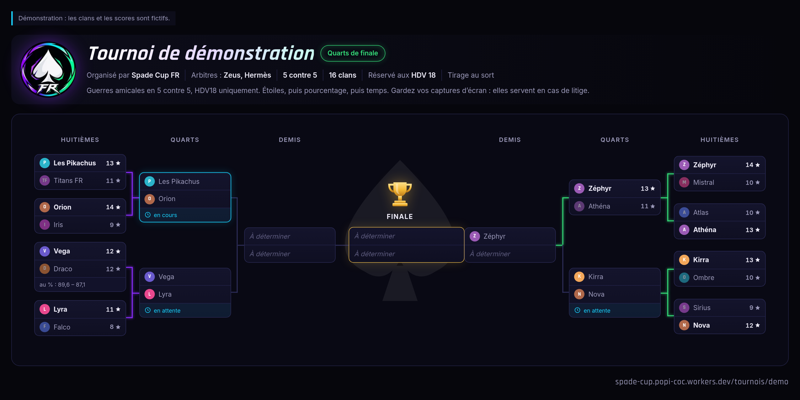

# Spade Cup FR

[](https://github.com/AbdelhakimEKT/spade-cup/actions/workflows/ci.yml)

Tournois de guerres amicales Clash of Clans entre clans francophones, en
**5 contre 5, HDV 18**. Les clans s'inscrivent sur Discord, l'arbre est tiré au
sort, les résultats sont lus directement dans l'API du jeu, et chaque joueur
entre au classement.

- **Site** : https://spade-cup.popi-coc.workers.dev
- **API** : https://spade-cup-api.popi-coc.workers.dev
- Les règles et les choix techniques, expliqués simplement : page
  [Comment ça marche](https://spade-cup.popi-coc.workers.dev/a-propos)

## Stack

- **Angular 22** : composants autonomes, signals, sans zone.js, `httpResource`
- **SCSS** avec des jetons de design en variables CSS (thèmes sombre et clair)
- **Cloudflare Workers** : le site (fichiers statiques) et le serveur (TypeScript)
- **D1** (SQLite) pour la base de données
- **Bot Discord** par requêtes HTTP signées (Ed25519), sans connexion permanente
- **Vitest** partout : site, logique partagée, et serveur dans le vrai moteur Cloudflare
- **GitHub Actions** : tests à chaque push, mise en ligne automatique sur `main`

## Organisation

```
src/
├─ styles/                jetons de design, base globale, éléments partagés (_ui)
├─ testing/               outils des tests (faux serveur, données de test)
└─ app/
   ├─ core/tournament/    LA LOGIQUE DU TOURNOI, en TypeScript pur, partagée avec le serveur :
   │                      arbre, départage, lecture des guerres du jeu, statistiques
   ├─ core/               services uniques : thème, titre des pages, réglages
   ├─ shared/             composants réutilisables : classement, blason, chargement/erreur
   ├─ layout/             en-tête et pied de page
   └─ features/           une page par dossier : accueil, tournois, matchs, joueurs, clans, règles
api/
├─ migrations/            le schéma de la base, une migration par évolution
├─ src/index.ts           les adresses de l'API
├─ src/repository.ts      tournois : le seul endroit qui écrit du SQL (avec stats-repository.ts)
├─ src/coc.ts             client de l'API du jeu (via un relais à IP fixe)
├─ src/discord/           le bot : signature, commandes, réponses
├─ scripts/               démo, déclaration des commandes Discord
└─ test/                  tests du serveur
wrangler.jsonc            mise en ligne du site
```

## Commandes

| Commande (à la racine) | Rôle |
|---|---|
| `npm start` | site en développement sur http://localhost:4200 |
| `npm test` | tests du site et de la logique partagée |
| `npm run build` | version de production dans `dist/` |

Le serveur a son propre `package.json` (les tests Cloudflare exigent une autre
version de Vitest). L'installer avec **npm 11** : npm 10.9 plante sur les
dépendances de Vitest 4.

```bash
cd api && npx npm@11 install
```

| Commande (dans `api/`) | Rôle |
|---|---|
| `npm test` | tests dans le vrai moteur des Workers, base D1 jetable vidée avant chaque test |
| `npm run typecheck` | vérification des types (serveur et scripts) |
| `npm run dev` | serveur local sur http://localhost:8787 |
| `npm run migrate` | applique les migrations à la base de production |
| `npm run seed:demo` | (ré)installe le tournoi de démonstration et ses joueurs |
| `npm run deploy` | met le serveur en ligne |
| `npx wrangler deploy -c ../wrangler.jsonc` | met le site en ligne (après `npm run build` à la racine) |

Pour développer le site contre un serveur local, remplacer `apiUrl` par
`http://localhost:8787` dans `src/app/core/site-config.ts`.

## API publique (lecture seule)

| Adresse | Rôle |
|---|---|
| `GET /tournaments` | liste des tournois |
| `GET /tournaments/:slug` | un tournoi complet : clans et arbre |
| `GET /tournaments/:slug/matches/:id` | un match et les lignes de ses joueurs |
| `GET /players[?tournament=slug]` | classement des joueurs (hors démo sans filtre) |
| `GET /players/:tag` · `GET /clans/:tag` | fiches, tag sans « # » |

Les écritures passent **uniquement** par le bot Discord (`POST /discord`).

## Bot Discord

| Commande | Qui | Rôle |
|---|---|---|
| `/inscription tag:` | tout le monde | inscrire son clan |
| `/desinscription tag:` | celui qui a inscrit, ou un admin | retirer un clan |
| `/tournoi` | tout le monde | où en est le tournoi |
| `/arbitre creer nom:` | arbitres | créer un tournoi, ouvrir les inscriptions |
| `/arbitre tirage` | arbitres | clore les inscriptions et tirer l'arbre |
| `/arbitre lancer match:` | arbitres | signaler qu'une guerre a commencé |
| `/arbitre resultat match:` | arbitres | lire le résultat dans le jeu |
| `/arbitre score match: …` | arbitres | saisir le score à la main (secours) |
| `/arbitre vainqueur match: clan:` | arbitres | forfait, égalité parfaite, litige |
| `/arbitre arbre [tournoi:]` | arbitres | publier l'image de l'arbre dans le salon (le tournoi courant, ou un autre, la démo par exemple) |
| `/arbitre annuler nom:` | arbitres | supprimer le tournoi courant (test, erreur) ; retaper son nom pour confirmer |

**Important pour les arbitres** : l'API du jeu ne garde que la DERNIÈRE guerre
de chaque clan. Lancer `/arbitre resultat` avant que les deux clans aient
relancé une autre guerre (le bot essaie les deux clans).

`/arbitre` est réservé par défaut à « Gérer le serveur » ; les admins peuvent
l'ouvrir à un rôle Arbitre dans *Paramètres du serveur → Intégrations*.

### Mise en route (faite le 23/10/2026)

Application Discord : identifiant `1563155880034177115`. Sa clé publique est
dans `DISCORD_PUBLIC_KEY` (`api/wrangler.jsonc`) : elle n'est pas secrète.

1. Portail développeur Discord → *Informations générales* → **URL du point de
   terminaison des interactions** : `https://spade-cup-api.popi-coc.workers.dev/discord`
   (Discord vérifie l'adresse en envoyant une requête signée).
2. Déclarer les commandes, **à relancer à chaque changement de
   `src/discord/commands.ts`**, avec le jeton du bot (onglet *Bot* →
   *Réinitialiser le token*), passé le temps de la commande et jamais écrit
   dans un fichier :
   ```bash
   DISCORD_APPLICATION_ID=1563155880034177115 DISCORD_BOT_TOKEN=… npm run register:commands
   ```
   Le serveur, lui, n'a jamais besoin de ce jeton.
3. Inviter le bot sur le serveur du tournoi :
   https://discord.com/oauth2/authorize?client_id=1563155880034177115&scope=applications.commands
4. Clé de l'API du jeu (compte développeur dédié à Spade Cup), créée avec
   l'IP **45.79.218.79** (celle du relais RoyaleAPI), puis :
   ```bash
   npx wrangler secret put COC_API_TOKEN
   ```

### Image de l'arbre

`/arbitre arbre` fait ouvrir la page du tournoi (`?capture`) par un vrai
navigateur hébergé par Cloudflare (*Browser Rendering*, gratuit jusqu'à
10 minutes par jour, environ 8 secondes par image), qui en fait une capture
d'écran envoyée en pièce jointe. Réservé aux arbitres pour protéger ce quota.



Essai sans Discord, sur le vrai navigateur :
`npx wrangler dev scripts/capture-check.ts --remote --port 8799`, puis
http://localhost:8799/?tournoi=demo

### Diagnostics

- https://spade-cup-api.popi-coc.workers.dev/health?coc : `"coc":"ok"` si la
  clé du jeu fonctionne (au plus un vrai appel toutes les 5 minutes, la clé
  n'est jamais affichée).
- Lire une guerre comme le bot, sans rien enregistrer :
  ```bash
  COC_API_TOKEN=… npm run check:war -- "#TAGDUCLAN" "#TAGADVERSE"
  ```

## Mise en ligne automatique

Le workflow `.github/workflows/ci.yml` lance tous les tests à chaque push. Sur
`main`, il met aussi le serveur et le site en ligne, si deux secrets existent
dans *Settings → Secrets and variables → Actions* : `CLOUDFLARE_API_TOKEN`
(jeton Cloudflare avec les droits *Workers Scripts* et *D1* en écriture) et
`CLOUDFLARE_ACCOUNT_ID`.
